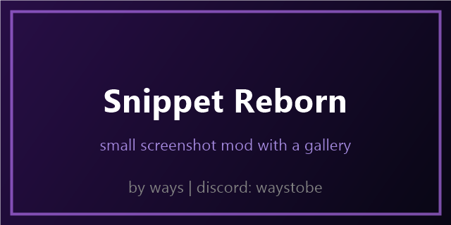

# snippet reborn

a small screenshot mod for fabric 1.21.11. it is a full rewrite, nothing was copied from the old snippet mod.

press F10 to take a screenshot. after any screenshot the chat shows 4 buttons: copy, view, open and delete. press G to open the gallery with all your screenshots, click one to see it big. in the viewer you can go back, copy it to the clipboard, open it in explorer or delete it (it asks first).

pictures are resized to the exact pixels they use on your screen so they stay sharp.

## settings

mod menu has two options: sharp thumbnails (on makes small pre sized pictures, off uses the full size) and chat buttons on or off. the config file is snprb.json and there is a /snprb command.

## install

you need fabric loader 0.19 or newer and fabric api. mod menu is only needed if you want the settings screen. put the jar from the releases page in your mods folder.

## build

`./gradlew build`, the jar ends up in build/libs. `./gradlew runClientGameTest` runs the tests.

all rights reserved, see LICENSE.
